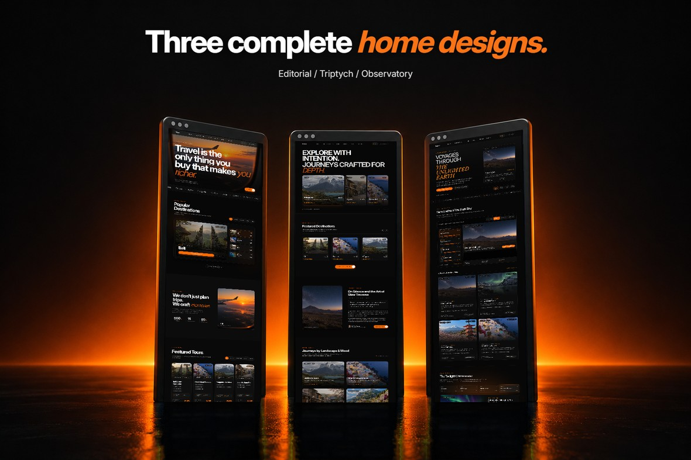

# Talkwer

An open-source travel editorial and tour showcase built with Next.js 16, React
19, TypeScript, and Tailwind CSS v4. Use it to explore interface ideas, learn
from the implementation, or build your own travel site.

[Live demo](https://talwker.vercel.app) · [Getting started](#getting-started) ·
[Contributing](CONTRIBUTING.md) · [MIT license](LICENSE)



## What's included

- Three home designs and three destination listing/detail layout families.
- Tour itineraries, editorial stories, and informational pages.
- Three login/register designs and sample admin/customer dashboards.
- A date/time booking flow with a browser-session checkout demonstration.
- English, Spanish, and Japanese interface dictionaries with locale-aware
  routing.
- Self-hosted Inter, local demo images, responsive layouts, and reduced-motion
  support.

English uses unprefixed URLs; Spanish and Japanese use `/es` and `/ja`.
Translation coverage is partial: some editorial content and supporting pages
remain English.

## Getting started

Use **Node.js 22.19+** and **pnpm 12.6.0** (also declared in `package.json`).

```sh
git clone https://github.com/S0vers/talwker.git
cd talwker
npm install -g pnpm@12.6.0
pnpm install --frozen-lockfile
pnpm dev
```

Open [localhost:3560](http://localhost:3560). No accounts, API keys, or database
are needed.

For your own deployment, copy `.env.example` to `.env.local` and set:

```dotenv
NEXT_PUBLIC_SITE_URL=https://your-domain.com
```

This public value controls canonical URLs, social previews, robots, and the
sitemap. Rebuild after changing it. Without it, the project uses the original
demo domain.

For a production preview:

```sh
pnpm build
pnpm start
```

Open [localhost:3000](http://localhost:3000). If development serves missing CSS,
use the production preview for visual checks. For another port, use
`pnpm exec next start -p 3001`.

## Explore the demo

| Feature            | Routes                                                                          |
| ------------------ | ------------------------------------------------------------------------------- |
| Home designs       | `/`, `/home-2`, `/home-3`                                                       |
| Destinations       | `/destinations`, `/destinations-2`, `/destinations-3` and their detail routes   |
| Tours and stories  | `/tours`, `/stories` and their detail routes                                    |
| Information        | `/about`, `/contact`, `/experiences`, `/faq`, `/careers`, `/press`, `/partners` |
| Account UI         | `/login`, `/register`, plus `-2` and `-3` variants                              |
| Dashboard previews | `/dashboard`, `/dashboard/customer`                                             |
| Booking demo       | Start on a tour detail, choose a slot, then continue to `/checkout`             |

## What works locally

This project is a frontend showcase, with no application backend.

| Flow                     | Current behavior                                                                                                     |
| ------------------------ | -------------------------------------------------------------------------------------------------------------------- |
| Login and registration   | Validate form fields and simulate navigation; no account or session is created                                       |
| Booking and checkout     | Store sample guest details and a confirmation in the current tab's session storage; no reservation or payment occurs |
| Payment fields           | Read-only sample values filled by the demo button; no payment data is sent or stored                                 |
| Dashboards               | Sample records and local UI state; changes do not persist to a database                                              |
| Contact and applications | Open an email draft using the visitor's mail application                                                             |
| Newsletter               | Validate email and show demo feedback; no subscription is created                                                    |
| Storage notice component | Optional reusable UI; omitted from the default demo, which has no analytics or advertising integration               |

Use fictional guest details and passwords. Closing the tab clears its session
data. A production service needs server-side authentication, authorization,
inventory and price validation, persistence, email delivery, and a payment
provider. Sample policies, testimonials, prices, and business claims are
illustrative and should be replaced.

## Project structure

```text
src/app/[locale]/       App Router routes, metadata, and feature composition
src/pages/[locale]/     Static default homepage with build-time copy/data
src/features/           Page entries, sections, feature content, and helpers
src/shared/             Shared compositions and domain types
src/components/ui/      Low-level UI primitives
src/lib/                SEO, GSAP lifecycle, utilities, and content guards
src/i18n/               Locale routing and message loading
dictionary/             English, Spanish, and Japanese messages
public/                 Local images and fonts
docs/                   Architecture, accessibility, SEO, and release guidance
documentation/          Offline HTML customization guide
scripts/                Quality checks and maintenance tools
```

The default homepage is statically generated with the Pages Router and
build-time translations. Other pages use the App Router. Navigation across these
router boundaries loads a new document; both use the same feature modules and
styles.

To customize:

- Edit shared destinations and tours in `src/features/home/content/`, and
  stories in `src/features/stories/content/`. Tours declare their filter
  `styles` explicitly; story reading times are estimated from the actual
  localized body text.
- Edit page-specific copy in the feature's `content/` folder and interface
  messages in `dictionary/`.
- Change styles and tokens in `src/app/globals.css`. Tailwind v4 uses CSS
  configuration; there is no `tailwind.config.ts`.
- Update SEO defaults in `src/lib/seo.ts`, and replace brand references, contact
  details, icons, and sample policies.
- Add pages using an existing feature as a reference. Keep route files thin and
  page UI under `src/features/<name>/sections/`.

The [design and code review](docs/DESIGN_REVIEW.md) records verified fixes and
visual evidence. [Performance budgets](docs/PERFORMANCE_BUDGETS.md) describe the
mobile measurement profile and hosting requirements.

See the [docs index](docs/INDEX.md) for architecture and the
[offline guide](documentation/index.html) for detailed customization
instructions.

## Checks

```sh
pnpm verify           # Lint, types, filenames, image sizing/bytes, production build
pnpm deps:audit       # Production dependency advisories
```

Individual commands include `pnpm lint`, `pnpm typecheck`,
`pnpm check:filenames`, `pnpm check:image-sizes`, and
`pnpm check:public-image-bytes`. There is no dedicated application test suite.
Check changed interactions in a production preview as well as running the gates.

`pnpm audit:mobile http://localhost:3000` runs five fresh mobile Chrome audits
against a production preview and fails if any LCP is 2.5 seconds or above.
Install Chrome first and run it without other checks or browser automation
competing for resources. Reports are written to the ignored
`.reports/mobile-lcp/` directory.

`pnpm audit:preview-links http://localhost:3000` crawls English server-rendered
internal links. It does not exercise forms or JavaScript interactions.
`pnpm format:check` reports formatting; the repository still contains
pre-existing formatting inconsistencies, so format only files you change.

## Deployment

Use a host that supports Next.js and Node.js 22.19+. Install with the lockfile,
set `NEXT_PUBLIC_SITE_URL`, build with `pnpm build`, and serve with `pnpm start`
or your host's Next.js integration. The build script uses Next.js's supported
Webpack compiler. Locale proxy routing, dynamic list routes, and image
optimization require a Next.js-capable host; plain static hosting is
insufficient.

## Contributing and support

Bug reports and focused pull requests are welcome. Read
[CONTRIBUTING.md](CONTRIBUTING.md) before making changes. Report vulnerabilities
privately using [SECURITY.md](SECURITY.md). Community support is provided
through [GitHub issues](https://github.com/S0vers/talwker/issues); there is no
purchase code or paid support requirement.

The project began as a marketplace template. `docs/marketplace/` and artwork
tooling preserve that history; marketplace submission checks are not open-source
release gates.

## License and credits

Copyright © 2026 Sovers Tonmoy Pandey (s0vers). Original project code and
author-generated demo imagery are available under the [MIT license](LICENSE).

Third-party components and dependencies retain their respective licenses.
Preserve the notices in [Licensing/](Licensing/) and consult
[third-party credits](docs/THIRD_PARTY_LICENSES.md). Inter is licensed under the
[SIL Open Font License](public/fonts/OFL.txt). Image provenance is retained in
[the asset inventory](docs/marketplace/assets.json).
