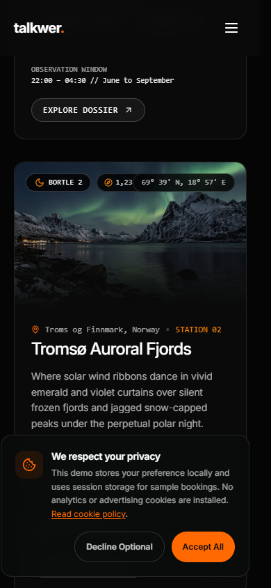
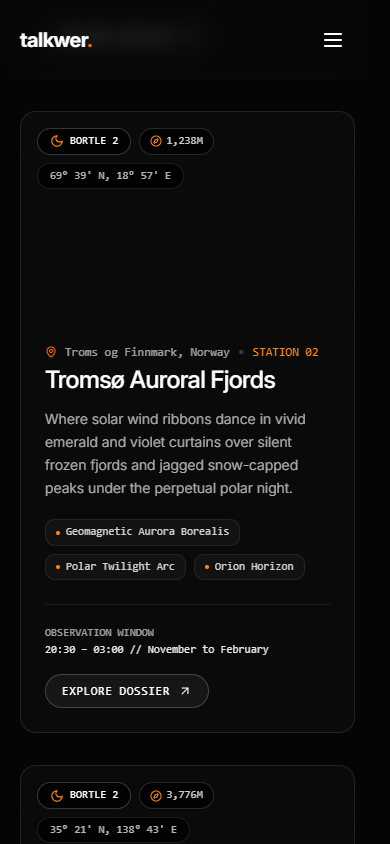
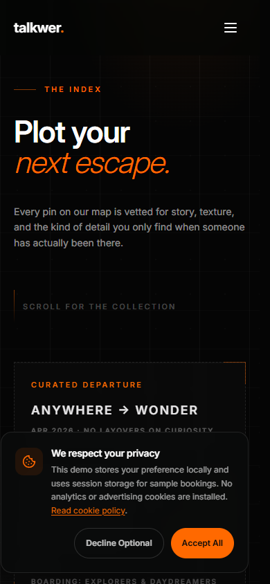
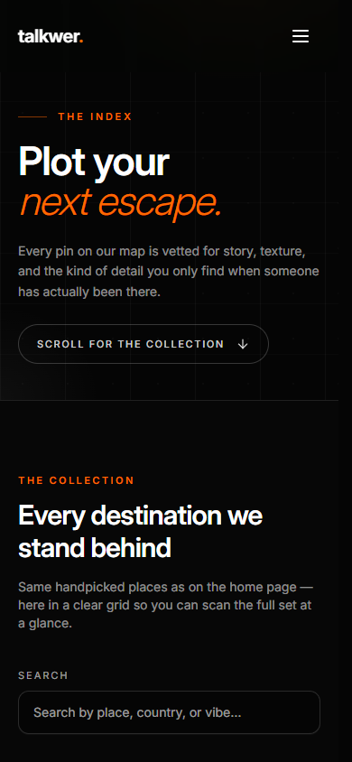

# Design and codebase review

Reviewed October 27, 2026. Method: dual-agent, independent design assessment A
(`/root/design_assessment`) and technical assessment B
(`/root/technical_assessment`), followed by implementation and production
verification in the main chat. The technical detector findings were withheld
until the visual assessment was complete.

## What the rejection evidence actually says

The earlier internal review is
[marketplace/READINESS.md](marketplace/READINESS.md), with a
[performance follow-up](marketplace/PERFORMANCE.md). It gave a 12/20 technical
snapshot while also making an overconfident statement that the work possible in
code was complete. Its own contrast and performance caveats should have
prevented that conclusion.

The private Envato daily proofing digest received October 27 confirms that
Talkwer was hard rejected. It contains no item-specific explanation. Private
correspondence has not been copied into this public repository. The related
support acknowledgment concerns the missing review notification, not a design
assessment. The available earlier chat content also supplied no detailed
reviewer findings.

Envato's
[published quality expectations](https://help.author.envato.com/hc/en-us/articles/360000424523-Envato-s-Item-Quality-Expectations)
cover presentation, technical quality, usability, and accurate descriptions. Its
[review-process guide](https://help.author.envato.com/hc/en-us/articles/360000471923-How-to-Get-Your-Items-Through-Review-at-Envato)
explains that detailed feedback is generally unavailable for hard rejections.
Those are general criteria, not proof of the reason for this item.

**Assessment:** uneven finish, content credibility, and interactions that
promised more than they delivered are plausible rejection contributors. They are
not confirmed Envato findings. Code gates establish correctness within their
scope; they do not establish marketplace suitability or visual distinction.

## What should stay

The independent visual review found a recognizable identity: consistent dark
surfaces, orange emphasis, photographic framing, and three meaningfully
different compositions. The tour itinerary and story body have a useful
hierarchy. The default, atelier, and observatory families are intentional
choices, not accidental duplicated pages. A wholesale rebrand would not address
the verified failures below.

## Verified findings and implemented fixes

| Priority before fixes | Finding and impact                                                                                         | Implementation                                                                                                                                                                                                        |
| --------------------- | ---------------------------------------------------------------------------------------------------------- | --------------------------------------------------------------------------------------------------------------------------------------------------------------------------------------------------------------------- |
| P1                    | Coordinates covered the elevation badge on observatory cards at 390px                                      | Unified all three image badges into one wrapping container in `nocturnal-waypoints.tsx`                                                                                                                               |
| P1                    | The first-visit consent overlay occupied about a quarter of the mobile viewport and obscured content       | Removed its default mount from `SiteFrame`; the optional reusable component remains available, and documentation reflects the absence of optional tracking                                                            |
| P1                    | The observatory configurator discarded all selections on dispatch                                          | The inquiry link carries a bounded draft and topic into the contact route, which validates them and prepopulates the form; the concierge link now preserves the same draft rather than opening an invalid booking URL |
| P1                    | A visual waveform claimed lossless audio and offered fake audio controls                                   | Renamed the interaction as a visual signal simulation with accurate pause/resume labels; no media playback is implied                                                                                                 |
| P1                    | Small white text on solid orange controls measured about 2.9:1                                             | Used dark foregrounds for primary actions, selected states, and orange hover states; updated the shared primary foreground token and text selection                                                                   |
| P1                    | Body copy, prices, metadata, and captions used unreadable low opacity                                      | Raised contrast in the reviewed homepage, shared tour cards, destination controls, story recommendations, captions, and shared CTA                                                                                    |
| P2                    | Destination search was pushed beyond the introductory mobile screen by a decorative ticket and empty space | Compressed the mobile introduction, retained the ticket on desktop, and made the browse cue a working search anchor                                                                                                   |
| P2                    | Observatory options communicated selection only by appearance                                              | Added `aria-pressed`, labeled groups/fieldsets, and larger small controls                                                                                                                                             |
| P2                    | Decorative pulses and programmatic smooth scrolling ignored reduced motion                                 | Gated pulse animations with reduced-motion utilities and used instant scrolling when the preference requests it                                                                                                       |
| P2                    | A roughly 350-word story advertised seven minutes of reading                                               | Derive estimates from the actual body, including localized body text; image alt text is excluded and Japanese uses a character-based approximation                                                                    |
| P2                    | Tour categories were inferred from highlight wording and discount fields                                   | Added explicit typed `Tour.styles` and a single style-filter helper; Patagonia correctly appears under Adventure, and a discount no longer implies Luxury                                                             |
| P2                    | The destination stage preloaded its next large slide and rotated before it was visible                     | Use an intersection observer to defer next-slide loading and autoplay until the stage is visible, while retaining server-rendered initial content                                                                     |
| P2                    | Hover/focus pauses could reset a deliberate manual slideshow pause                                         | Separate the manual pause setting from temporary interaction pauses and preserve hover/focus state correctly                                                                                                          |

The Bortle metric now has an explanation, the configurator's labels use direct
questions, its long option names wrap, and its absolute light-contamination
guarantee was replaced with an explicit sample label. These are targeted clarity
corrections, not a replacement visual direction.

## Before and after

### Mobile station cards

Before: elevation is covered by coordinates, and the fixed notice covers the
card content.

After: badges wrap and the content remains visible.

### Mobile destination browsing

Before: a decorative ticket fills the lower screen and search is out of view.

After: the introductory action reaches search, which is visible in the initial
viewport at 390 by 844.

## Independent baseline usability assessment

The design assessor scored the initial interface, before these fixes. These
subjective quality scores are not acceptance probabilities and are not an
accessibility certification. No new score is invented for the patched
implementation.

| Nielsen heuristic       | Quality, 0 poor to 4 excellent | Baseline observation                                                                |
| ----------------------- | ------------------------------ | ----------------------------------------------------------------------------------- |
| System status           | 3                              | Selection was visually visible but not consistently exposed to assistive technology |
| Match to real world     | 2                              | Specialist observatory terminology needed explanation                               |
| User control            | 3                              | Familiar navigation, but the notice obstructed first-visit content                  |
| Consistency             | 3                              | Coherent families with isolated rendering flaws                                     |
| Error prevention        | Not scored                     | Submission/error states were outside the visual assessor's scope                    |
| Recognition over recall | 2                              | Dense metrics required interpretation                                               |
| Efficiency              | 2                              | Mobile destination browsing began too late                                          |
| Minimalist design       | 2                              | Atmospheric identity competed with overlay and technical density                    |
| Error recovery          | Not scored                     | Error states were outside that assessment's scope                                   |
| Help                    | 2                              | Specialist terms lacked context                                                     |
| Total                   | **19/32**                      | Eight heuristics assessed                                                           |

The destination-seeking mobile visitor and novice night traveler faced the
highest avoidable cognitive load. The editorial reader faced inaccurate depth
cues. The fixes address those problems while retaining the observatory's
specialist character.

## Codebase assessment

The feature-first layout and thin routes are useful and should remain. No
shared-to-feature boundary violation was confirmed in the reviewed scope.
Duplication of complete page families is intentional; extracting a universal
page component would make them harder to maintain.

The important implementation problems were weak domain modeling and broken
handoffs: deriving taxonomy from display copy, hardcoding derived reading-time
metadata, discarding configurator state, and conflating persistent pause intent
with transient hover/focus. These now have small explicit owners:

- `Tour.styles` in the shared domain, used directly by tour filters
  model.
- `src/shared/lib/story-reading-time.ts`, used by catalog validation and
  localization.
- `src/features/contact/lib/contact-draft.ts`, with form props passed through
  the thin contact route. Contact now uses request-time query data and remains
  dependent on a Next.js-capable host.
- Separate manual and interaction pause state in the destination feature.

No new runtime dependency or test framework was introduced.

## Verification

- `pnpm verify` passed, including lint, types, filename discipline, image
  sizing/bytes, and production build.
- Twelve ad hoc content-model regressions passed: taxonomy stability under
  copy/price changes, reading-time calculation and image-alt exclusion, Japanese
  estimates, and bounded contact-draft parsing.
- Production Chrome confirmed all ten configurator options expose selection,
  chosen destination/stay/gear survive dispatch, the topic is preserved, and the
  draft reaches the contact form.
- Mobile station badges have non-intersecting rectangles; destination search is
  in the first 390 by 844 viewport and the anchor focuses it.
- Reduced-motion checks found no running waveform pulses; the visualization
  control changes its actual state.
- Manual slideshow pause remains set after leaving the stage with mouse and
  keyboard focus.
- The prior booking, checkout, Spanish-calendar, locale-navigation, carousel,
  and twelve-route smoke checks still passed, with no uncaught page errors.
- English internal-link crawl: 43 destinations, zero failures.
- Axe WCAG A/AA checks across `/`, `/home-2`, `/home-3`, `/destinations`, and
  one story detail reported zero violations after fixes. The initial scan
  flagged 29 elements, including transient notice-animation contrast. This is
  bounded automated coverage, not site-wide certification.
- The mechanical Impeccable detector found two warnings and zero errors. Both
  `side-tab` warnings were reviewed as contextual false positives: an
  established editorial pull-quote border and an active table-of-contents
  indicator. Neither was removed to game the scan.
- Fresh Chrome screenshots covered desktop and mobile; functional checks
  included normal and reduced motion. Other browsers and physical devices were
  not certified in this review.

## Performance result and remaining priority

Default mobile simulated Lighthouse navigation on local production Chrome, one
before/after pair:

| Metric            | Before      | After       |
| ----------------- | ----------- | ----------- |
| Performance       | 85          | 87          |
| Simulated LCP     | 4.4 seconds | 4.1 seconds |
| Transferred bytes | 682 KiB     | 595 KiB     |
| CLS               | 0           | 0           |

This was an improvement of about 87 KiB in that lab run, not field Core Web
Vitals or a statistical guarantee. At that stage, the 2.5-second LCP budget
remained unmet and the largest early resource was the approximately 143 KiB font
preload, followed by application JavaScript.

Compact machine-readable evidence is in
[verification.json](reviews/2026-10-27/verification.json). Full temporary
reports and tooling were kept outside the repository. The historical
[performance report](marketplace/PERFORMANCE.md) remains a dated record.

### October 28 follow-up

The homepage now uses specific travel copy and four independently masked
headline rows in English, Spanish, and Japanese. Articles have a narrower
reading measure, a stronger opening paragraph, and clearer quote spacing. The
dark/orange palette, imagery, section order, and authored motion remain intact.

Application optimizations include a 41,408-byte core variable font with extended
Latin on demand, server-resolved home/navigation copy and testimonial cards,
smaller initial CSS, compact card data, and deferred offscreen imagery and
interaction engines. Four desktop/mobile editorial screenshots preserve the body
below the header pixel-for-pixel through the performance refactors. Production
checks covered 108 localized routes, mobile menu focus, carousel behavior,
client navigation styling, and no-JavaScript card images.

The static Pages Router homepage passed five fresh default mobile Lighthouse
runs: 2.483s, 2.482s, 2.481s, 2.483s and 2.482s. Other routes retain the App
Router. See the [current performance evidence](reviews/2026-10-28/README.md) and
[budgets](PERFORMANCE_BUDGETS.md) for the normal Next.js measurements. No proxy
or hosting-specific performance configuration is required.

Partial translation coverage and the lack of a persistent automated test suite
remain documented project limits. Authentication, payment, inventory, and
dashboards remain frontend demonstrations. Repository visibility and hosting
configuration were not changed.

The user supplied the implementation scope and authorized the fixes.

## Tooling note

The existing Impeccable sidecar/configuration is stale relative to the installed
skill. Unknown top-level keys are `project`, `live`, `context`, `doctor`,
`hooks`, and `ignores`; ignored detector keys are `enabled`, `cli`, and `rules`.
The current code review did not rely on those settings or silently rewrite them.
The installed skill also advertised v4.8.0 as an available update; a tool/config
refresh was left outside this implementation pass.
